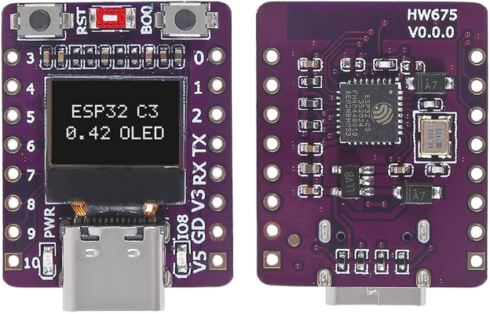

# ESP32-C3 Heart Rate Monitor (Onboard 0.42" OLED + MAX30102)

A pocket-sized heart rate monitor. Put a finger on a MAX30102 sensor and the
ESP32-C3 board's tiny built-in OLED shows your BPM, a heart that pulses with every
beat, and a live pulse waveform.

> **Hardware used:** ESP32-C3 development board with the **onboard 0.42" (72x40) OLED**
> and a **MAX30102** sensor breakout. No external display needed.

  

## Features

- Live BPM (averaged over the last 4 beats)
- Heart icon that grows on every detected beat
- Scrolling pulse waveform graph
- "Place finger" prompt when no finger is detected
- Serial output of raw IR, BPM and average for debugging

## Hardware

| Part | Notes |
|---|---|
| ESP32-C3 board with onboard 0.42" OLED | SSD1306-type, 72x40 pixels, I2C address `0x3C` |
| MAX30102 breakout | I2C address `0x57` |
| 4 jumper wires | |

### Wiring

The OLED is already wired on the board to **GPIO5 (SDA)** and **GPIO6 (SCL)**. The
sensor shares the same I2C bus.

| MAX30102 | ESP32-C3 |
|---|---|
| VIN | 3V3 |
| GND | GND |
| SDA | GPIO5 |
| SCL | GPIO6 |
| INT | not connected |

> Power the sensor from **3.3V**, not 5V.

## Software setup

1. Install the [Arduino IDE](https://www.arduino.cc/en/software) and the **ESP32** board package.
2. Install these libraries from **Library Manager**:
   - **SparkFun MAX3010x Pulse and Proximity Sensor Library**
   - **U8g2** (olikraus)
3. Select the board **ESP32C3 Dev Module**.
4. Set **USB CDC On Boot: Enabled** (otherwise the Serial Monitor stays blank).
5. Open `esp32c3_max30102_oled042.ino` and upload.

Serial Monitor baud rate: `115200`.

## Usage

1. Power the board. The OLED shows **Place finger on sensor...**
2. Rest a fingertip **lightly** on the sensor window. Do not press hard, since that cuts
   blood flow and ruins the signal.
3. Hold still. The BPM settles after about 10 to 20 seconds.

The heart grows on every beat and the graph scrolls along the bottom.

## Configuration

| What | Where | Default |
|---|---|---|
| I2C pins | `SDA_PIN`, `SCL_PIN` | `5`, `6` |
| Finger detection threshold | `ir > 50000` | `50000` |
| Red LED brightness | `setPulseAmplitudeRed()` | `0x1F` |
| Graph sensitivity | `range < 150` in `drawWave()` | `150` |
| Graph speed | draw interval `40` ms in `loop()` | `40` |
| Waveform upside down | sign in `pushWave()`: `-(ir - dc)` | inverted |

## Troubleshooting

**"Sensor not found" on the OLED**
- Check that SDA goes to GPIO5 and SCL to GPIO6, and that VIN is on 3V3.
- Reflow the header pins on the sensor. Loose joints are common on these boards.
- Run an I2C scanner on `Wire.begin(5, 6)`. You should see `0x3C` (OLED) and `0x57` (sensor).

**Scanner finds random or changing addresses**
- The bus is floating. Check that the sensor wires are connected firmly to the correct pins.

**Scanner finds nothing, even for the OLED**
- The sensor module may be loading the bus. Disconnect it and scan again. The OLED should
  still appear at `0x3C`.
- Some green MAX30100-style boards have pull-ups tied to a 1.8V rail. Remove the two
  `472` (4.7k) resistors on the module and rely on the pull-ups on the ESP32 board.

**Sensor found but init still fails (MAX30100 library)**
- Read the part ID from register `0xFF`. `0x11` means MAX30100 and `0x15` means MAX30102.
  This project uses the **SparkFun MAX3010x** library, which is for the **MAX30102**.

**Readings are noisy or the BPM jumps**
- Hold your finger still, apply light pressure, and shield the sensor from bright light.

**IR value stays near 1000 with a finger on**
- The finger isn't covering the window. Raise LED current if needed with
  `setPulseAmplitudeIR(0x3F)` and `setPulseAmplitudeRed(0x3F)`.

## Notes

- This is a hobby project and **not a medical device**. Do not use it for diagnosis.
- SpO2 is not shown. It needs the library's `spo2_algorithm.h` and is far less stable
  than BPM on these sensors.

## Credits

Built by **Antony's Garage** (@code_antony).
Libraries: SparkFun MAX3010x, U8g2.
